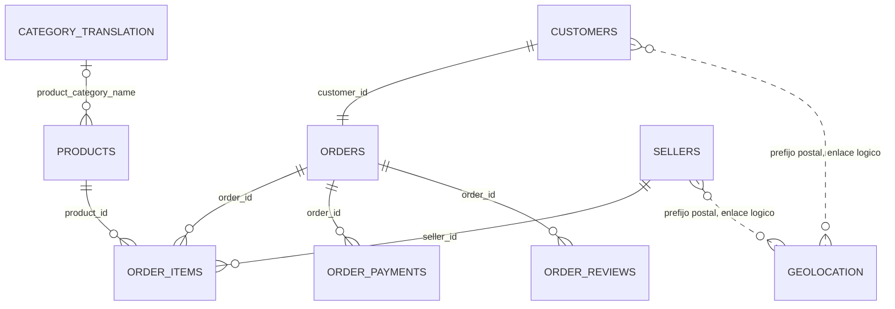
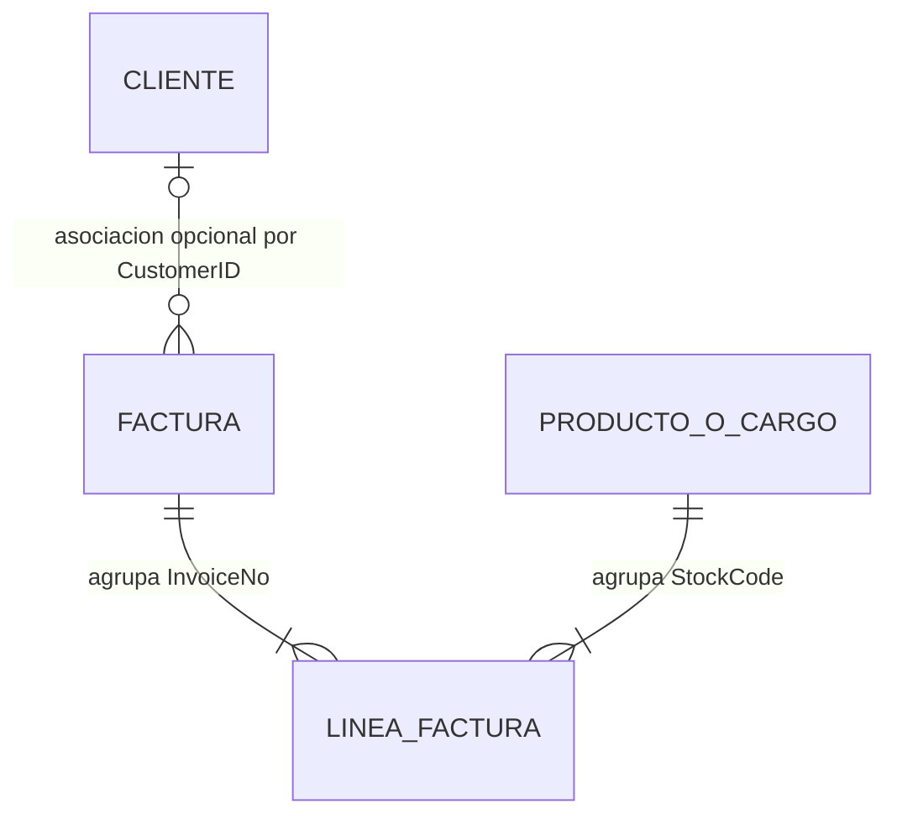
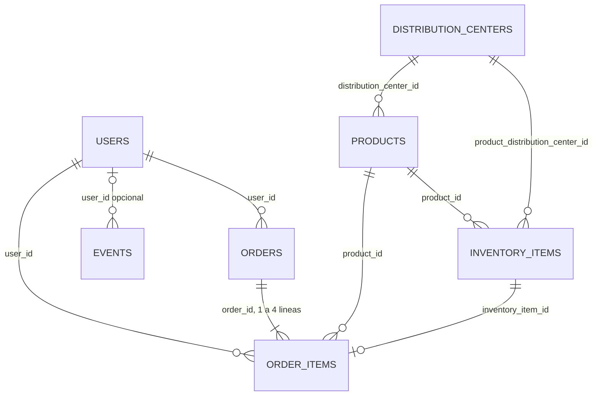

# Comercio electrónico: informe ejecutivo técnico

El proyecto evalúa tres fuentes independientes para definir qué decisiones y productos analíticos pueden sostener. El resultado es un diagnóstico de estructura, calidad y viabilidad: conocer las tablas y sus unidades de análisis es necesario para calcular indicadores sin duplicar operaciones. Sus poblaciones, periodos y monedas difieren; no se cruzan clientes ni se suman importes.

| Fuente | Qué contiene | Cobertura | Prioridad propuesta |
| --- | --- | --- | --- |
| Olist | Marketplace: pedidos, vendedores, pagos y satisfacción; nueve CSV relacionados | 2016–2018; BRL; archivos individuales locales | Cumplimiento de entrega y satisfacción |
| Online Retail | Una tabla de líneas de facturas de un comercio británico | 2010-12-01 a 2011-12-09; GBP; Excel local | Concentración y recurrencia de clientes conocidos |
| The Look | Siete entidades de comercio, inventario y navegación descritas por tres CSV agregados | Pedidos de 2019-01-09 a 2026-10-12; moneda pendiente | Aclarar semántica antes de medir stock y logística |

Las prioridades siguientes son propuestas derivadas de los hallazgos, no intervenciones evaluadas. El análisis no estima efectos causales, beneficios ni ingresos auditados.

## 1. Olist

Marketplace brasileño: compras, artículos de distintos vendedores, pagos, entrega y reseñas. Permite estudiar el servicio logístico y su asociación con la satisfacción.

### Estructura y lectura de los datos

| Tabla / entidad original | Filas | Una fila representa | Clave | Contenido y uso |
| --- | ---: | --- | --- | --- |
| orders | 99.441 | Pedido | order_id | Estado y ciclo de compra/entrega |
| customers | 99.441 | Registro de cliente por pedido | customer_id | customer_unique_id identifica recurrencia; ubicación |
| order_items | 112.650 | Artículo dentro de un pedido | order_id + order_item_id | Producto, vendedor, precio y flete |
| order_payments | 103.886 | Registro de pago | order_id + payment_sequential | Medio, cuotas e importe |
| order_reviews | 99.224 | Registro de reseña | review_id no es único | Puntuación y comentarios opcionales |
| products | 32.951 | Producto | product_id | Categoría y atributos físicos |
| sellers | 3.095 | Vendedor | seller_id | Ubicación del vendedor |
| geolocation | 1.000.163 | Observación de un prefijo postal | Sin clave por prefijo | Coordenadas y localidad; múltiples observaciones |
| product_category_name_translation | 71 | Traducción de categoría | product_category_name | Correspondencia portugués–inglés |

PK indica clave candidata; FK, campo de enlace. En Online Retail el segundo diagrama es conceptual, todavía no materializado. The Look describe el esquema mediante agregados exportados; no se inspeccionaron sus registros individuales.

### Normalización y reglas para analizar

Las entidades están separadas en tablas; el detalle comercial, los pagos y las reseñas son hechos distintos. Esta separación reduce repetición, pero no demuestra por sí sola tercera forma normal. customer_id identifica un registro por pedido: hay 96.096 identidades customer_unique_id y 2.997 aparecen en varios registros. La recurrencia debe usar esa segunda clave.

| Detalle | Pedidos sin registro | Pedidos con varios registros | Máximo por pedido |
| --- | ---: | ---: | ---: |
| order_items | 775 | 9.803 | 21 |
| order_payments | 1 | 2.961 | 29 |
| order_reviews | 768 | 547 | 3 |

Denominador: 99.441 pedidos en cada fila. Un LEFT JOIN directo de artículos × pagos × reseñas produciría **119.143 filas**, en vez de 99.441 pedidos; repetiría medidas. El análisis agrega cada detalle y valida uniones 1:1. Para categorías o vendedores se conserva una tabla de líneas separada y se cuentan pedidos distintos.

Geolocation contiene 19.015 prefijos; 17.972 tienen varias observaciones. Antes del enlace postal se necesita una dimensión de una fila por prefijo y una regla explícita de selección de coordenadas. Las reseñas necesitan una clave técnica si se almacenan como registros; review_id no basta. No se ha creado esa normalización física.

### Resultados y límites decisivos

Sobre **99.441 pedidos**, la entrega mediana es **10,22 días**. De 96.470 entregados con fechas completas, **8,11%** llegó después de la estimación registrada.

La reseña media es **4,29/5 a tiempo** y **2,57/5 tarde**, entre pedidos con reseña. La demora se asocia con menor puntuación, sin demostrar causalidad. Los meses parciales, faltantes y selección de entregados limitan la comparación. Los importes son BRL nominales.

[Informe Olist](edas/olist/reports/informe_eda.md). Fuente: Olist, Kaggle versión 2; CC BY-NC-SA 4.0.

### Valor y siguiente decisión

| Decisión que puede apoyar | Base analítica | Condición / límite |
| --- | --- | --- |
| Priorizar revisión del servicio de entrega | Pedido: demora, reseña, flete y ubicación | Segmentar por mes, vendedor y categoría; asociación sin causalidad |
| Detectar diferencias de conciliación | Pedido: pagos frente a precio + flete | Revisar discrepancias antes de clasificarlas como error |
| Estudiar recurrencia | customer_unique_id y pedidos distintos | Ventana histórica; no sustituir por customer_id |

La siguiente propuesta con mayor respaldo es un tablero de cumplimiento y satisfacción con denominadores visibles. Una intervención sobre vendedores o rutas exige comprobar diferencias de composición; este EDA no demuestra su efecto.

## 2. Online Retail

Transacciones de un comercio británico: líneas de facturas con productos o cargos, cantidades, precios y cliente cuando está identificado. Permite estudiar concentración y recurrencia comercial.

### Estructura y lectura de los datos

| Tabla / entidad original | Filas | Una fila representa | Clave | Contenido y uso |
| --- | ---: | --- | --- | --- |
| Online Retail | 541.909 | Línea del Excel | Sin identificador único de línea | InvoiceNo, StockCode, Description, Quantity, InvoiceDate, UnitPrice, CustomerID y Country |

PK indica clave candidata; FK, campo de enlace. En Online Retail el segundo diagrama es conceptual, todavía no materializado. The Look describe el esquema mediante agregados exportados; no se inspeccionaron sus registros individuales.

### Normalización y reglas para analizar

El Excel es una tabla plana y repite datos de factura y producto. InvoiceNo + StockCode tiene **10.684 repeticiones adicionales**: no es una clave de línea. Conservar una fila_origen técnica permitiría identificar cada registro sin borrar duplicados.

La comprobación de dependencias funcionales cuenta valores distintos, incluidos nulos, dentro de cada grupo. De 25.900 facturas, 0 tienen varios valores de cliente, 0 varios países y 43 varias fechas. De 4.070 códigos, 1.324 tienen varias descripciones y 3.603 varios precios.

Se propone separar factura, línea, cliente conocido y producto/cargo, sin presentar esas entidades como tablas existentes. La fecha original, la descripción y el precio se conservan en la línea; no se elige silenciosamente un valor por producto o factura. Importe = Quantity × UnitPrice es una medida derivada. La ausencia de cliente se conserva y las cancelaciones no tienen vínculo verificable con su compra original.

### Resultados y límites decisivos

Las **19.960 facturas de ventas positivas** suman **GBP 10.666.684,54**. Reino Unido reúne **84,61%** de ese importe. El 10% superior de los 4.338 clientes identificados concentra **61,38%** de las ventas identificadas.

Falta cliente en **24,93%** de las líneas. Las cancelaciones y ajustes se distinguen de ventas positivas; no se emparejaron devoluciones con compras. La concentración es un hallazgo; no confirma margen ni estabilidad futura.

[Informe Online Retail](edas/online_retail/reports/informe_eda.md). Fuente: Daqing Chen, UCI (2015); CC BY 4.0.

### Valor y siguiente decisión

| Decisión que puede apoyar | Base analítica | Condición / límite |
| --- | --- | --- |
| Priorizar seguimiento comercial | Cliente conocido: frecuencia e importe | Cobertura parcial; no representa a clientes anónimos |
| Planificar revisión del mix y concentración | Línea y factura positiva, por país/mes | Incluye cargos; meses parciales y sin costos |
| Separar venta y ajustes | Línea clasificada por signo y prefijo C | No equivale a devoluciones emparejadas ni cobros |

La siguiente propuesta con mayor respaldo es segmentación descriptiva de clientes conocidos y un tablero de concentración. La concentración permite evaluar dependencia comercial; no justifica campañas ni predice abandono sin evaluación adicional.

## 3. The Look

Modelo de comercio electrónico que conecta usuarios, pedidos, catálogo, unidades de inventario y navegación. En este proyecto solo se dispone de perfiles y distribuciones agregados, no de las siete tablas individuales.

### Estructura y lectura de los datos

| Tabla / entidad original | Filas | Una fila representa | Clave | Contenido y uso |
| --- | ---: | --- | --- | --- |
| users | 100.000 | Usuario | id | Perfil y ubicación |
| orders | 125.303 | Pedido | order_id | Usuario, estado, fechas y número de artículos |
| order_items | 181.458 | Línea de pedido | id | Pedido, usuario, producto, unidad, estado y sale_price |
| products | 29.120 | Producto | id | Categoría, departamento, costo y precio de catálogo |
| inventory_items | 489.869 | Unidad de inventario | id | Producto, centro, costo y fechas |
| events | 2.426.096 | Evento de navegación | id | Usuario opcional, sesión, secuencia y tipo |
| distribution_centers | 10 | Centro de distribución | id | Nombre y ubicación |

PK indica clave candidata; FK, campo de enlace. En Online Retail el segundo diagrama es conceptual, todavía no materializado. The Look describe el esquema mediante agregados exportados; no se inspeccionaron sus registros individuales.

### Normalización y reglas para analizar

El esquema separa entidades y hechos, pero conserva redundancias: user_id está en pedido y línea; inventario replica atributos de producto y centro. Pueden representar una instantánea histórica, hipótesis que debe confirmarse antes de reemplazarlos por atributos actuales del catálogo. No se certifica una forma normal solo por tener claves únicas.

Los agregados indican claves únicas y no nulas en siete tablas y cobertura total en nueve enlaces no nulos. También indican concordancia de usuario pedido–línea y producto línea–unidad. No disponemos de filas para reconstruir esos cruces o normalizar físicamente el modelo. Los tres CSV locales son perfiles, distribuciones y relaciones; sus filas son métricas agregadas, no compradores ni pedidos.

Para una futura base analítica: una tabla de pedidos y otra de líneas, dimensiones de usuario/producto/centro y un hecho separado de eventos. Agregar líneas por pedido antes de unir; mantener eventos por sesión. El enlace por usuario entre eventos y pedidos es N:M y no demuestra atribución.

### Resultados y límites decisivos

Las exportaciones de BigQuery reúnen **125.303 pedidos**, **181.458 líneas** y **2.426.096 eventos**. Las claves son únicas y los nueve enlaces comprobados cubren todas las referencias no nulas. Las líneas suman **10.795.147,15**, pero solo **2.685.055,36** corresponde al estado Complete; la moneda y el reconocimiento de ingresos no están documentados.

**29,96%** de las líneas con creación y envío tiene el envío anterior a su creación. Además, todas las líneas enlazan unidades sin sold_at, aunque el inventario cuenta 181.458 unidades con esa fecha. Se requiere aclarar estas diferencias antes de interpretar stock o tiempos. El **46,41%** de eventos no tiene usuario; no se atribuye conversión a pedidos.

[Informe The Look](edas/the_look/reports/informe_eda.md). Fuente: CSV agregados aportados tras ejecutar BigQuery; origen exacto y licencia pendientes de confirmar.

### Valor y siguiente decisión

| Decisión que puede apoyar | Base disponible | Condición / límite |
| --- | --- | --- |
| Describir demanda por estado, país y categoría | Distribuciones exportadas | No son ingresos netos ni destino confirmado |
| Diseñar un modelo analítico | Esquema y perfiles de relaciones | Obtener filas autorizadas para materializarlo |
| Priorizar correcciones de semántica | Alertas de fechas y unidad–línea | Confirmar fuente, extracción, moneda y estados |

La siguiente propuesta con mayor respaldo es aclarar el contrato de datos antes de un tablero de stock o logística. Los eventos permiten describir actividad agregada; un embudo de conversión necesita definición de sesión, secuencia y enlace de compra que estas exportaciones no resuelven.

## Criterio para avanzar

Olist y Online Retail permiten construir bases analíticas a partir de sus registros locales, manteniendo detalles y agregados separados. The Look permite diseñar el modelo y describir distribuciones; las anomalías temporales y de inventario requieren aclaración antes de indicadores operativos. La integridad de claves no garantiza coherencia de negocio.

Cada informe mantiene la misma estructura: alcance, tablas y relaciones, normalización, hallazgos, calidad, valor y trazabilidad. El detalle de indicadores, gráficos, licencias y huellas permanece en los informes enlazados; la reproducción se documenta en [metodología](docs/metodologia.md).
