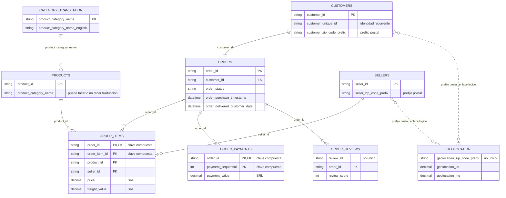

# Olist: diagrama ER

El **pedido** es el centro del modelo. Una fila de order_items es una línea de pedido; pagos y reseñas tienen sus propios registros.

## Relaciones principales

| Relación | Lectura |
| --- | --- |
| customers → orders | 1:1 por customer_id en el archivo observado |
| orders → líneas, pagos y reseñas | 1:N; algunos pedidos no tienen registros asociados |
| products y sellers → order_items | Cada línea identifica un producto y un vendedor |
| traducción → products | Una categoría agrupa productos; puede faltar la traducción |
| clientes/vendedores ↔ geolocation | Un prefijo puede repetirse en ambos lados; enlace postal N:M |

`customer_id` corresponde al registro del cliente del pedido. Para reconocer recurrencia se usa `customer_unique_id`, que puede repetirse. `CATEGORY_TRANSLATION` representa la tabla original product_category_name_translation.

## Precauciones de unión

**Agregar antes de unir:** sumar price y freight_value por pedido, sumar pagos y promediar reseñas. Después unir a orders y comprobar que se conservan sus 99.441 pedidos. Unir los detalles directamente puede multiplicar filas e importes.

`review_id` no es único: hay 814 repeticiones adicionales. Geolocation tampoco tiene una clave única por prefijo; debe prepararse una fila por prefijo antes de usarla como dimensión. Hay 610 productos sin categoría y 13 sin traducción; conservar esos faltantes.

[Informe EDA](../../edas/olist/reports/informe_eda.md) · [Claves](../../edas/olist/reports/tables/claves.csv) · [Referencias](../../edas/olist/reports/tables/integridad_referencial.csv) · [Mermaid editable](olist.mmd)
