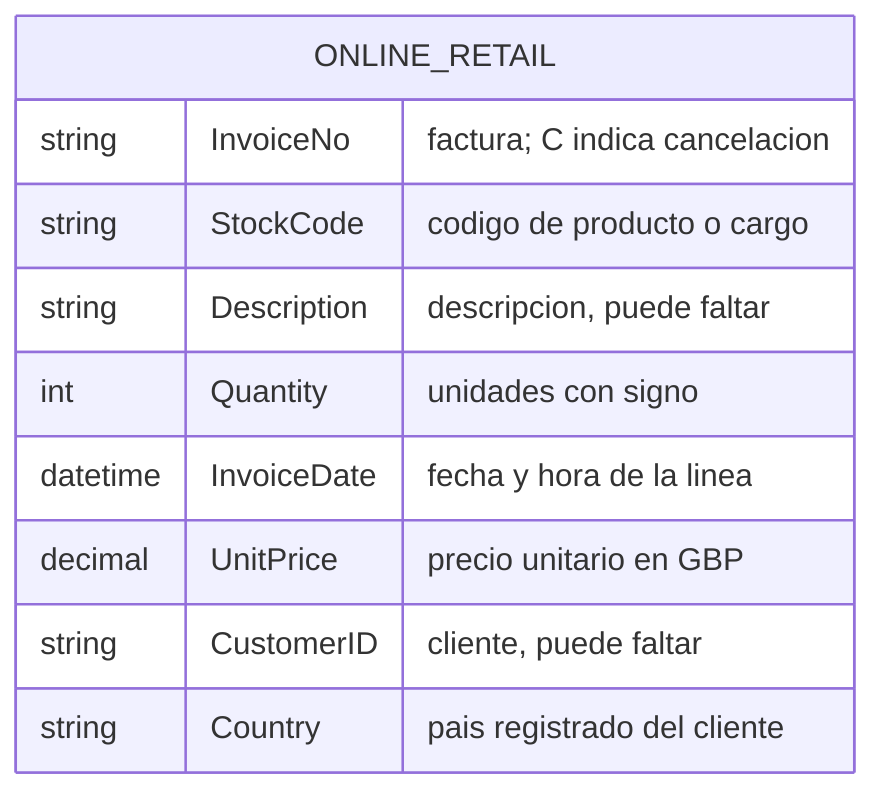
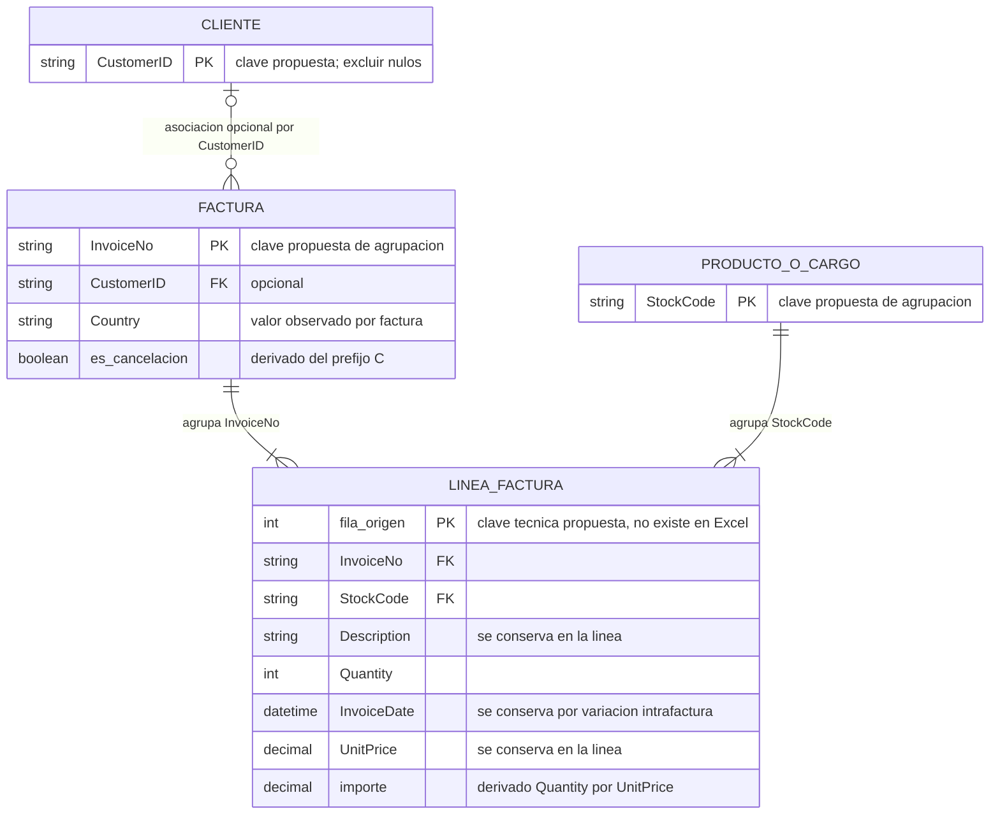

# Online Retail: diagrama ER

## Archivo original

Online Retail.xlsx contiene **una sola tabla**, con 541.909 líneas. InvoiceNo agrupa las líneas de una factura; no identifica una fila.

## Modelo conceptual

Este segundo diagrama explica las entidades que podrían separarse. **No son tablas existentes ni una transformación realizada.** Sus claves son propuestas.

| Relación | Lectura |
| --- | --- |
| cliente → facturas | 1:N; una factura puede no tener cliente conocido |
| factura → líneas | 1:N por InvoiceNo |
| producto o cargo → líneas | 1:N por StockCode |

## Precauciones de interpretación

**InvoiceNo + StockCode no es una clave única:** tiene 10.684 repeticiones adicionales. fila_origen es una clave técnica propuesta para distinguir líneas, incluidos duplicados.

Falta CustomerID en el 24,93% de las líneas. Description y UnitPrice pertenecen a la línea: no se presume descripción ni precio único por producto. La fecha también se conserva allí, porque 43 facturas tienen dos valores de InvoiceDate.

El importe es Quantity × UnitPrice, en GBP. El prefijo C identifica cancelaciones, pero no hay una clave que las enlace con la venta original. No se calcula una tasa de devolución a partir de esa relación inexistente.

[Informe EDA](../../edas/online_retail/reports/informe_eda.md) · [Calidad](../../edas/online_retail/reports/tables/calidad.csv) · [Mermaid original](online_retail_original.mmd) · [Mermaid conceptual](online_retail_conceptual.mmd)
