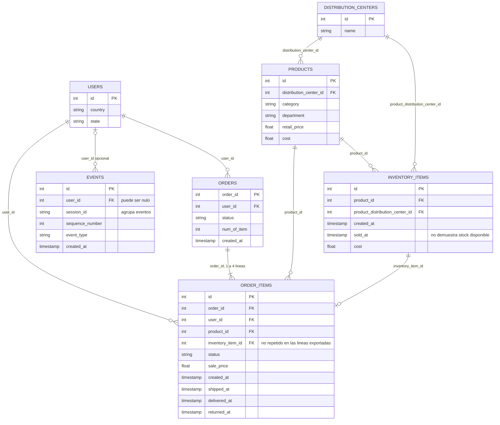

# The Look: diagrama ER

El modelo conecta **pedidos y líneas** con usuarios, productos, unidades de inventario y centros. Los eventos describen actividad del usuario; no tienen una clave directa hacia pedidos.

## Relaciones comprobadas en las exportaciones

| Relación | Lectura |
| --- | --- |
| users → orders | 1:N; hay usuarios sin pedidos |
| orders → order_items | 1:N; cada pedido observado tiene entre 1 y 4 líneas |
| users → order_items | 1:N; el usuario coincide con el del pedido en los casos comparables |
| products → líneas e inventario | 1:N; cada registro referencia un producto existente |
| inventory_items → order_items | 1:0..1; una unidad aparece como máximo en una línea |
| distribution_centers → products e inventory_items | 1:N por los identificadores de centro respectivos |
| users → events | 1:N; el usuario del evento es opcional |

Las siete claves candidatas son únicas y no nulas. Los nueve enlaces tienen 100% de cobertura entre referencias no nulas, sin padres duplicados. Estas conclusiones proceden de agregados exportados, no de una nueva consulta al origen.

## Precauciones de unión e interpretación

**Para analizar pedidos, agregar primero sus líneas.** Una unión desde orders a order_items repite los atributos del pedido; no sumar num_of_item después de esa unión.

El 46,41% de eventos no tiene user_id. session_id agrupa eventos, pero no enlaza con orders. Unir eventos y pedidos solo por usuario produciría combinaciones, sin demostrar que una sesión generó una compra.

Las 181.458 líneas apuntan a unidades sin sold_at, aunque el inventario contiene 181.458 unidades con esa fecha. La coincidencia de conteos no demuestra que sean las mismas unidades. **No interpretar sold_at nulo como stock disponible.**

Las fechas de envío son anteriores a la creación en el 29,96% de líneas comparables. El modelo relacional no valida esa cronología ni permite afirmar ingresos netos; sale_price debe interpretarse por estado y su moneda no está confirmada.

[Informe EDA](../../edas/the_look/reports/informe_eda.md) · [Relaciones](../../edas/the_look/reports/tables/relaciones.csv) · [Alertas temporales](../../edas/the_look/reports/tables/alertas_temporales.csv) · [Mermaid editable](the_look.mmd)
