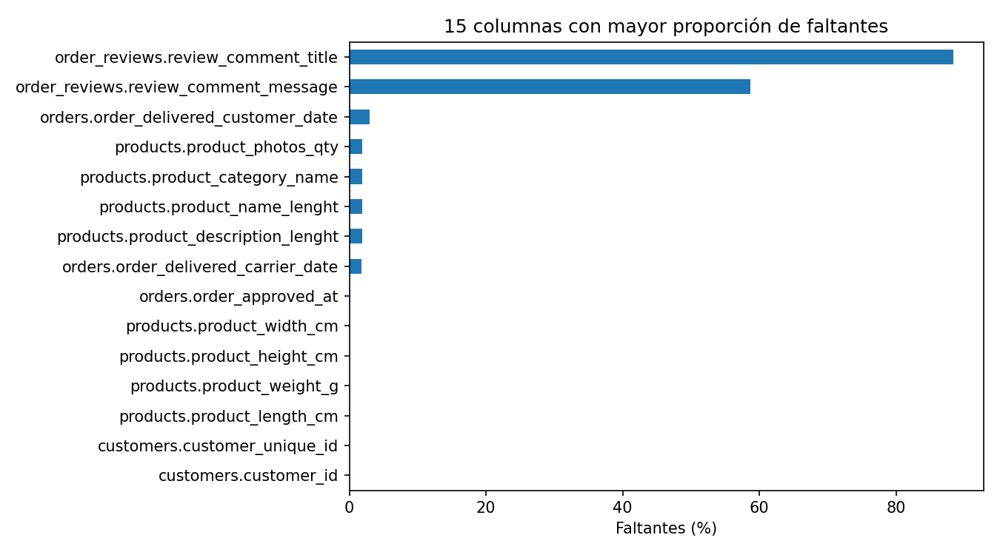
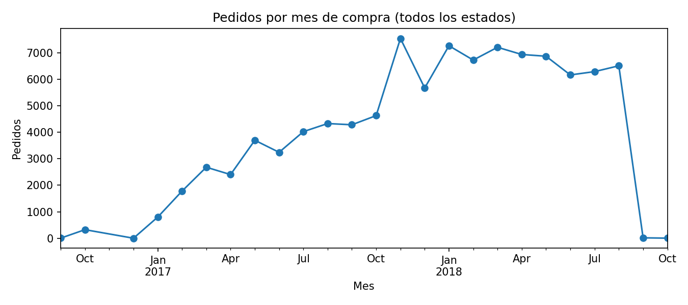
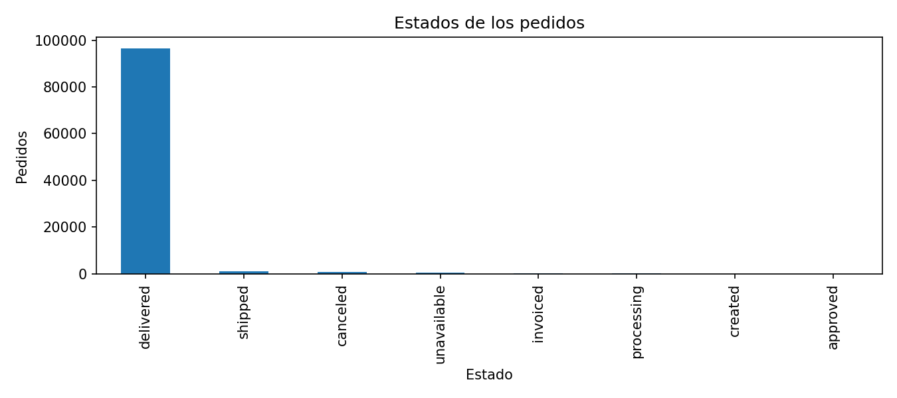
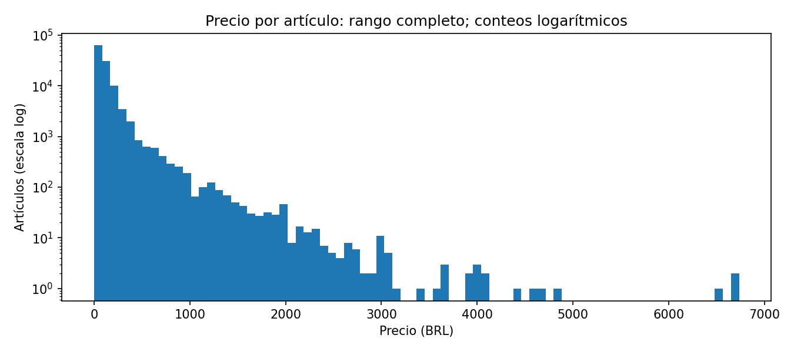
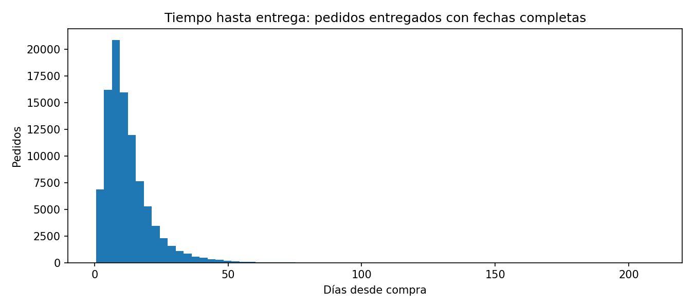
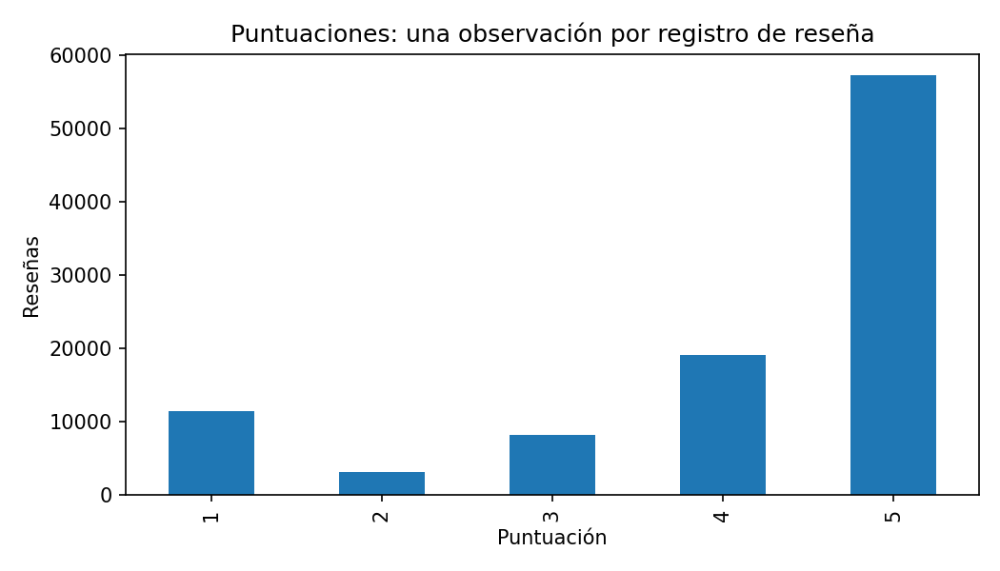
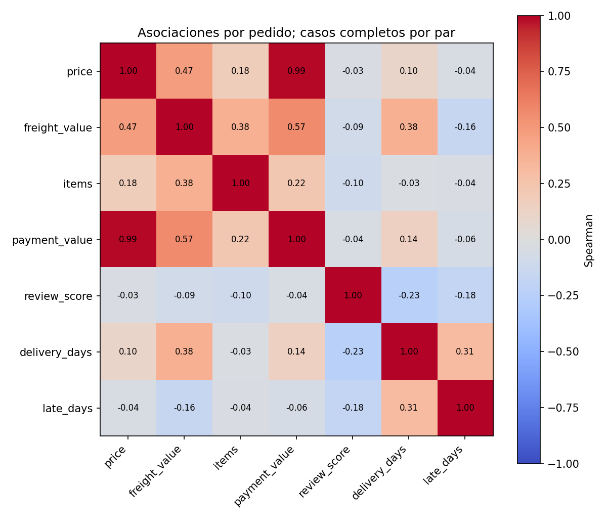

# Informe EDA: Brazilian E-Commerce Public Dataset by Olist

## Fuente, acceso y reproducción

Fuente: [Olist en Kaggle](https://www.kaggle.com/datasets/olistbr/brazilian-ecommerce), versión 2, nueve CSV. La documentación describe pedidos de 2016–2018 de distintos marketplaces. Descarga pública comprobada sin cuenta ni token. Licencia del dataset: [CC BY-NC-SA 4.0](https://creativecommons.org/licenses/by-nc-sa/4.0/): atribución, uso no comercial y compartir adaptaciones bajo la misma licencia. Olist es la fuente; este análisis no está afiliado a Olist.

ZIP observado: 44,717,580 bytes (44.72 MB); CSV: 126,186,995 bytes (126.19 MB). SHA-256: `967e41e04fc306fe604e2a693f488995a8b41e5047418f8a5c8e4abd6deca784`. URL exacta y lista de archivos en `data/manifest.json` (generado localmente). Python 3.12.3, pandas 2.2.3, matplotlib 3.9.2. Los scripts calculan todas las cifras; no hay muestreo aleatorio.

## Dimensiones, tipos y calidad

| Tabla | Filas | Columnas | Duplicados completos | Celdas faltantes |
| --- | --- | --- | --- | --- |
| customers | 99441 | 5 | 0 | 0 |
| geolocation | 1000163 | 5 | 261831 | 0 |
| order_items | 112650 | 7 | 0 | 0 |
| order_payments | 103886 | 5 | 0 | 0 |
| order_reviews | 99224 | 7 | 0 | 145903 |
| orders | 99441 | 8 | 0 | 4908 |
| products | 32951 | 9 | 0 | 2448 |
| sellers | 3095 | 4 | 0 | 0 |
| product_category_name_translation | 71 | 2 | 0 | 0 |

Total: 1,550,922 filas distribuidas en tablas de distinta granularidad, no observaciones independientes sumables para inferencia. Inventario completo de columnas, tipos, faltantes y cardinalidad: [columnas_calidad.csv](tables/columnas_calidad.csv). Los identificadores y prefijos postales se leen como texto para preservar ceros iniciales. Las fechas originales se perfilan como texto y luego se convierten explícitamente para el análisis temporal; fallos de conversión: 0.

Los campos opcionales de título y comentario de reseña concentran faltantes; su ausencia no implica automáticamente un error. Las fechas de entrega dependen del estado del pedido. No se imputan faltantes ni se eliminan duplicados en los CSV originales.

| Tabla | Clave candidata | Repeticiones adicionales | Filas con clave nula |
| --- | --- | --- | --- |
| orders | order_id | 0 | 0 |
| customers | customer_id | 0 | 0 |
| products | product_id | 0 | 0 |
| sellers | seller_id | 0 | 0 |
| order_items | order_id, order_item_id | 0 | 0 |
| order_payments | order_id, payment_sequential | 0 | 0 |
| order_reviews | review_id | 814 | 0 |
| product_category_name_translation | product_category_name | 0 | 0 |

Una clave repetida no equivale a una fila completamente duplicada. Las reseñas pueden repetirse por identificador o por pedido: 551 filas adicionales comparten pedido. Se agregan las puntuaciones mediante su media por pedido. Geolocalización tiene 19,015 prefijos para 1,000,163 registros; no debe cruzarse por prefijo sin agregación previa. Coordenadas fuera de los límites físicos latitud/longitud: 0; esta prueba no valida fronteras de Brasil ni exactitud geográfica.

| Tabla | Columna | Referencia | Filas sin referencia | Claves nulas |
| --- | --- | --- | --- | --- |
| orders | customer_id | customers | 0 | 0 |
| order_items | order_id | orders | 0 | 0 |
| order_items | product_id | products | 0 | 0 |
| order_items | seller_id | sellers | 0 | 0 |
| order_payments | order_id | orders | 0 | 0 |
| order_reviews | order_id | orders | 0 | 0 |
| products | product_category_name | product_category_name_translation | 13 | 610 |

Las referencias se comprueban por fila, excluyendo claves nulas del conteo de referencias inexistentes. Detalles en [integridad_referencial.csv](tables/integridad_referencial.csv). Importes negativos de precio, flete o pago: 0; puntuaciones fuera de 1–5: 0; duraciones de entrega negativas: 0. Pagos con diferencia absoluta superior a BRL 0,05 respecto a precio más flete: 260 de 98,665 pedidos comparables. Es una discrepancia contable descriptiva, no prueba de fraude.

## Distribuciones y valores extremos

Compras observadas desde 2016-09-04 21:15:19 hasta 2018-10-17 17:30:18. Los extremos temporales pueden contener meses parciales; los conteos no miden crecimiento comparable ni demanda de todo Brasil.

Estadísticas de todas las columnas numéricas (N, media, desviación estándar, mediana, cuartiles, P95, P99 y extremos): [estadisticas_numericas.csv](tables/estadisticas_numericas.csv). Se señalan extremos fuera de Q1 − 1,5×IQR y Q3 + 1,5×IQR; no se borran ni se consideran errores por definición. En variables discretas o con IQR cero esta regla requiere cautela.

Precio por artículo: mediana BRL 74.99, media BRL 120.65, P99 BRL 890.00, máximo BRL 6735.00. Flete mediano BRL 16.26. La escala de conteos logarítmica permite mostrar la cola completa sin recortar precios.

Entre 96,470 pedidos entregados con fechas de compra, entrega y estimación disponibles, la mediana de entrega es 10.22 días y P95 29.27 días. 7,826 (8.11%) se entregaron después de la fecha estimada. Se compara la hora exacta con la estimación registrada (a menudo medianoche); no se presupone una tolerancia adicional.

## Relaciones entre variables

Artículos y pagos se suman por pedido; reseñas se promedian por pedido. Cruces validados uno a uno conservan 99,441 pedidos. Los pedidos sin artículos, pagos o reseñas conservan faltantes, no ceros. Precio representa suma de precios de líneas; flete suma por línea; pagos son registros de pago, no beneficio ni ingresos netos.

| late | pedidos | puntuacion_media | puntuacion_mediana |
| --- | --- | --- | --- |
| A tiempo | 88163 | 4.294292012144172 | 5.0 |
| Tarde | 7661 | 2.566505678109907 | 2.0 |

Hallazgo: correlación de Spearman entre duración de entrega y puntuación media del pedido = -0.235. Correlaciones calculadas con casos completos por par, sin asumir igualdad de muestras; tamaños en [n_pares_correlacion.csv](tables/n_pares_correlacion.csv), coeficientes en [correlaciones_spearman.csv](tables/correlaciones_spearman.csv). Las relaciones entre importe de artículos y pagos tienen un componente contable esperado.

Hipótesis: la experiencia de entrega podría estar relacionada con satisfacción. No se demuestra causalidad: categoría, vendedor, distancia, época y selección de quienes reseñan pueden influir en ambas variables. No se han estimado efectos causales, intervalos de confianza ni modelos predictivos.

## Limitaciones y decisiones

- Dataset histórico de una plataforma; no representa todo el comercio electrónico brasileño ni la situación actual.
- Un cliente por pedido (`customer_id`) no equivale a una persona distinta; `customer_unique_id` permite reconocer recurrencia, sin garantizar identidad real.
- Los faltantes de fechas y reseñas generan selección. Comparar puntualidad solo entre entregados con fechas completas excluye cancelaciones y pedidos en proceso.
- Múltiples reseñas se promedian sin escoger arbitrariamente una. La geolocalización se perfila, pero no se utiliza para estimar distancias o deducir domicilios.
- Las magnitudes monetarias se interpretan en BRL nominales; no se ajustan por inflación ni incluyen costos, impuestos o márgenes.
- Los extremos se conservan; su legitimidad requiere contexto externo. Los prefijos postales no son coordenadas únicas.
- El EDA describe asociaciones; no prueba significancia, representatividad ni causalidad.

## Artefactos y comprobaciones

Generados por `python scripts/eda.py`: ocho gráficos PNG, siete tablas de calidad/estadística más correlaciones y tamaños de pares, y [metricas.json](metricas.json). La descarga comprueba SHA-256, lista exacta de miembros y CRC del ZIP. Los cruces comprueban cardinalidad y conservación de pedidos. La comprobación independiente de archivos se ejecuta con `python scripts/validate.py`; sus resultados de la ejecución de referencia se registran en README.
