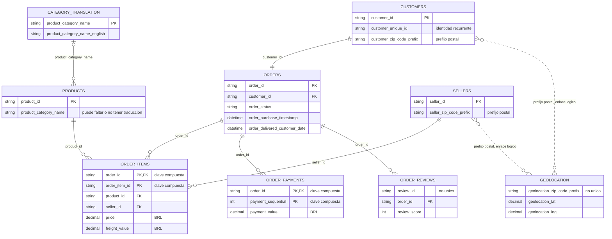
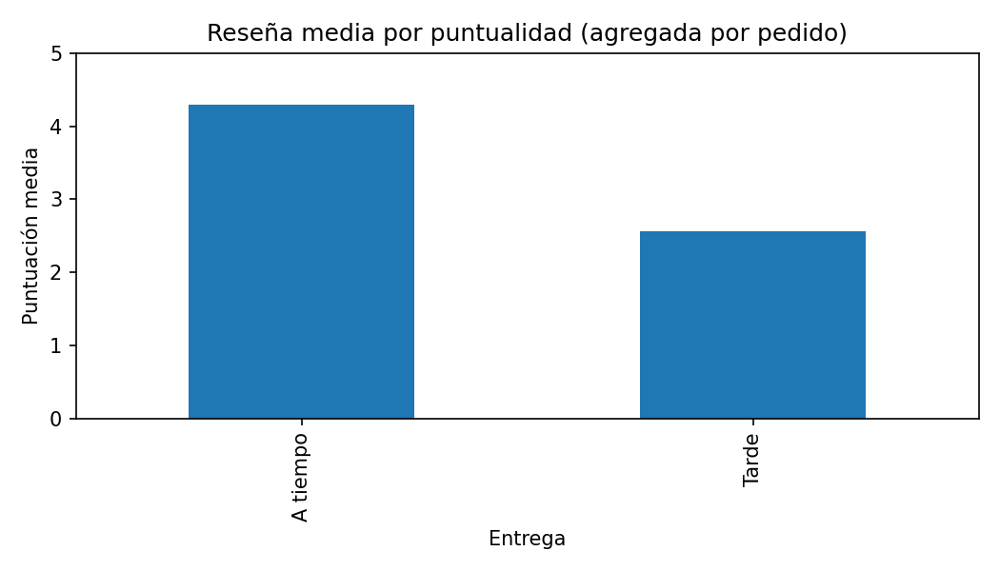

# Olist: informe de datos y viabilidad analítica

## 1. Propósito y alcance

Marketplace brasileño: compras, artículos de distintos vendedores, pagos, entrega y reseñas. Permite estudiar el servicio logístico y su asociación con la satisfacción.

**99,441 pedidos** de 2016–2018, distribuidos en nueve tablas. Fuente: [Olist en Kaggle](https://www.kaggle.com/datasets/olistbr/brazilian-ecommerce), versión 2, licencia [CC BY-NC-SA 4.0](https://creativecommons.org/licenses/by-nc-sa/4.0/). Los importes están en BRL nominales.

## 2. Tablas, granularidad y relaciones

| Tabla / entidad original | Filas | Una fila representa | Clave | Contenido y uso |
| --- | ---: | --- | --- | --- |
| orders | 99.441 | Pedido | order_id | Estado y ciclo de compra/entrega |
| customers | 99.441 | Registro de cliente por pedido | customer_id | customer_unique_id identifica recurrencia; ubicación |
| order_items | 112.650 | Artículo dentro de un pedido | order_id + order_item_id | Producto, vendedor, precio y flete |
| order_payments | 103.886 | Registro de pago | order_id + payment_sequential | Medio, cuotas e importe |
| order_reviews | 99.224 | Registro de reseña | review_id no es único | Puntuación y comentarios opcionales |
| products | 32.951 | Producto | product_id | Categoría y atributos físicos |
| sellers | 3.095 | Vendedor | seller_id | Ubicación del vendedor |
| geolocation | 1.000.163 | Observación de un prefijo postal | Sin clave por prefijo | Coordenadas y localidad; múltiples observaciones |
| product_category_name_translation | 71 | Traducción de categoría | product_category_name | Correspondencia portugués–inglés |

Las conexiones se leen de la entidad padre al detalle: uno a muchos, salvo las excepciones descritas. PK indica clave candidata y FK campo de enlace; los archivos no imponen restricciones de base de datos. Los diagramas muestran campos esenciales. En Online Retail, el segundo modelo es una propuesta; en The Look, el esquema se describe mediante exportaciones agregadas.

## 3. Normalización y construcción analítica

Las entidades están separadas en tablas; el detalle comercial, los pagos y las reseñas son hechos distintos. Esta separación reduce repetición, pero no demuestra por sí sola tercera forma normal. customer_id identifica un registro por pedido: hay 96.096 identidades customer_unique_id y 2.997 aparecen en varios registros. La recurrencia debe usar esa segunda clave.

| Detalle | Pedidos sin registro | Pedidos con varios registros | Máximo por pedido |
| --- | ---: | ---: | ---: |
| order_items | 775 | 9.803 | 21 |
| order_payments | 1 | 2.961 | 29 |
| order_reviews | 768 | 547 | 3 |

Denominador: 99.441 pedidos en cada fila. Un LEFT JOIN directo de artículos × pagos × reseñas produciría **119.143 filas**, en vez de 99.441 pedidos; repetiría medidas. El análisis agrega cada detalle y valida uniones 1:1. Para categorías o vendedores se conserva una tabla de líneas separada y se cuentan pedidos distintos.

Geolocation contiene 19.015 prefijos; 17.972 tienen varias observaciones. Antes del enlace postal se necesita una dimensión de una fila por prefijo y una regla explícita de selección de coordenadas. Las reseñas necesitan una clave técnica si se almacenan como registros; review_id no basta. No se ha creado esa normalización física.

## 4. Hallazgos y denominadores

| Indicador | Resultado | Población |
| --- | ---: | --- |
| Mediana de entrega | 10.22 días | 96,470 entregados con fechas completas |
| Percentil 95 de entrega | 29.27 días | Misma población |
| Entregados tarde | 7,826 (8.11%) | Misma población; después de la hora estimada |
| Reseña media a tiempo | 4.29/5 | 88,163 pedidos con reseña |
| Reseña media tarde | 2.57/5 | 7,661 pedidos con reseña |

Las entregas más largas se asocian con puntuaciones menores: Spearman **-0.235**, sobre 95,824 pedidos entregados con fechas y reseña. La asociación no demuestra causalidad; vendedor, categoría y selección de quienes reseñan pueden influir.

El precio por artículo tiene mediana **BRL 74.99** y P99 **BRL 890.00**. Los extremos se conservan. Hay **260 discrepancias superiores a BRL 0,05** entre pagos y precio más flete, sobre 98,665 pedidos comparables; no prueban fraude.

## 5. Calidad y límites de interpretación

Las claves de pedidos, clientes, productos y vendedores son únicas y las referencias principales están completas. Las reseñas repiten identificadores; la geolocalización repite prefijos. Hay 610 productos sin categoría y 13 sin traducción correspondiente. Los faltantes se mantienen, sin imputación.

Artículos y pagos se sumaron por pedido; reseñas se promediaron. Las uniones 1:1 conservan los 99,441 pedidos. La puntualidad excluye cancelaciones y entregas sin fechas completas. El dataset histórico no representa todo Brasil ni permite estimar margen.

## 6. Valor para el proyecto y siguiente decisión

| Decisión que puede apoyar | Base analítica | Condición / límite |
| --- | --- | --- |
| Priorizar revisión del servicio de entrega | Pedido: demora, reseña, flete y ubicación | Segmentar por mes, vendedor y categoría; asociación sin causalidad |
| Detectar diferencias de conciliación | Pedido: pagos frente a precio + flete | Revisar discrepancias antes de clasificarlas como error |
| Estudiar recurrencia | customer_unique_id y pedidos distintos | Ventana histórica; no sustituir por customer_id |

La siguiente propuesta con mayor respaldo es un tablero de cumplimiento y satisfacción con denominadores visibles. Una intervención sobre vendedores o rutas exige comprobar diferencias de composición; este EDA no demuestra su efecto.

## 7. Evidencia y trazabilidad

[Métricas](metricas.json), [dimensiones](tables/dimensiones.csv), [calidad](tables/columnas_calidad.csv), [claves](tables/claves.csv), [referencias](tables/integridad_referencial.csv), [estadísticas](tables/estadisticas_numericas.csv) y [denominadores de correlación](tables/n_pares_correlacion.csv). [Entrega](figures/entrega.png), [pedidos mensuales](figures/pedidos_mensuales.png) y [precios](figures/precios.png).

SHA-256 de la fuente: `967e41e04fc306fe604e2a693f488995a8b41e5047418f8a5c8e4abd6deca784`. Datos originales intactos y excluidos de Git.

[Diagnóstico estructural](estructura.json) · [Comprobaciones de granularidad o dependencias](tables/granularidad.csv).
