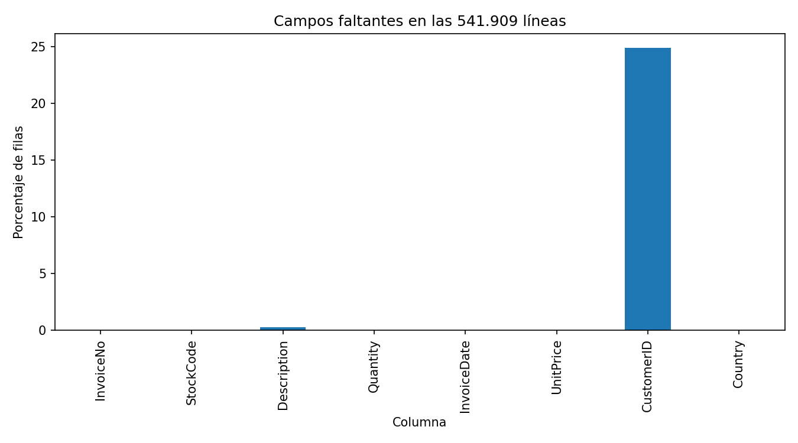
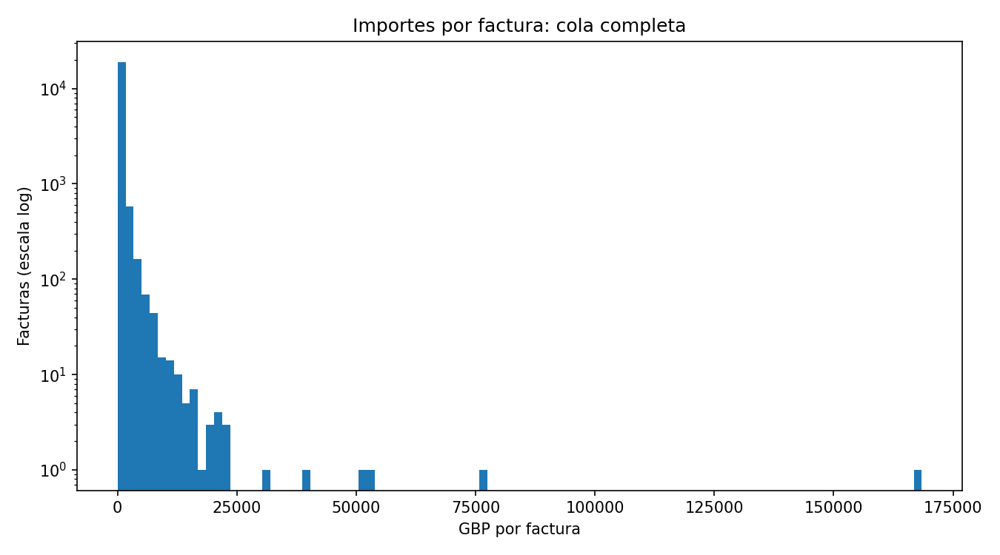
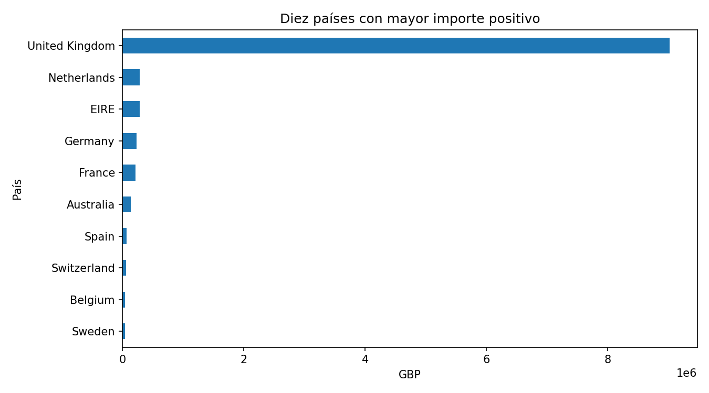
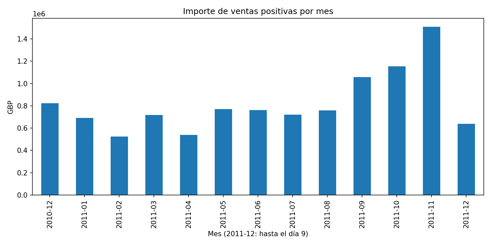

# Informe EDA: Online Retail (UCI)

## Alcance y calidad

Se analizaron 541,909 líneas y ocho columnas del comercio británico documentado por [UCI](https://archive.ics.uci.edu/dataset/352/online+retail), entre 2010-12-01 08:26:00 y 2011-12-09 12:50:00. Fuente: Daqing Chen (2015), DOI [10.24432/C5BW33](https://doi.org/10.24432/C5BW33), licencia [CC BY 4.0](https://creativecommons.org/licenses/by/4.0/). El importe es Quantity × UnitPrice, en GBP nominales; no representa beneficio ni cobro confirmado.

Hay 25,900 códigos de factura y 4,372 identificadores de cliente distintos no nulos. Faltan CustomerID en 135,080 líneas (24.93%) y Description en 1,454. Aunque la ficha de UCI declara ausencia de faltantes, el archivo observado sí los contiene. Se encontraron 5,268 duplicados completos adicionales: se mantienen porque no hay identificador de línea que permita determinar si son errores. Fechas inválidas o ausentes tras conversión: 0.

## Ventas, cancelaciones y ajustes

La población de ventas positivas exige factura y fecha disponibles, factura sin prefijo C, cantidad > 0 y precio > 0. Contiene 530,104 líneas y 19,960 facturas; conserva duplicados y extremos. Las 11,805 líneas restantes se mantienen en el perfil y en el balance firmado. Los códigos especiales de producto no se excluyen: el importe puede incluir portes y otros cargos.

Las ventas positivas suman GBP 10,666,684.54. Las facturas con prefijo C, que UCI identifica como cancelaciones, contienen 9,288 líneas, 3,836 facturas y un importe firmado de GBP -896,812.49. Este importe no es una tasa de devolución de ventas: no se enlazaron cancelaciones con compras originales y sus ventanas pueden diferir. El total firmado de todas las líneas es GBP 9,747,747.93; incluye ajustes y no equivale a ingresos netos auditados.

Se observan 10,624 cantidades negativas, 2,515 precios cero y 2 precios negativos. No se consideran errores automáticamente. [Segmentos y balance](tables/segmentos.csv), [calidad](tables/calidad.csv) y [estadísticas y extremos IQR](tables/estadisticas_numericas.csv) documentan las poblaciones.

## Distribución y concentración

La mediana del importe positivo por factura es GBP 303.84; P95 es GBP 1,585.92. La diferencia muestra una distribución asimétrica. No se recorta la cola ni se borra ninguna observación por IQR.

Reino Unido concentra 84.61% del importe de ventas positivas, con denominador GBP 10,666,684.54. Country es el país registrado del cliente; no demuestra el destino de entrega. [Detalle por país](tables/paises.csv).

Noviembre de 2011 suma GBP 1,509,496.33 en ventas positivas. Diciembre de 2011 termina el día 9 y es parcial: no debe compararse como un mes completo. El patrón mensual es compatible con estacionalidad, pero un solo ciclo no demuestra una pauta estable ni su causa. [Serie mensual](tables/ventas_mensuales.csv).

Entre 4,338 clientes identificados con ventas positivas, 2,845 (65.58%) tienen al menos dos facturas distintas dentro de la ventana observada. No es retención por cohorte. El 10% superior, redondeado hacia arriba a 434 clientes, concentra 61.38% del importe identificado (GBP 8,911,407.90). Los clientes ausentes se excluyen solo de esta población; no se imputan ni se agrupan como una persona. [Frecuencia agregada](tables/frecuencia_clientes.csv).

## Granularidad, relaciones y límites

Se agregan líneas por InvoiceNo antes de calcular tickets; no se unen tablas. 43 facturas tienen más de un valor de cliente, país o fecha contando el faltante como categoría. La tabla [consistencia](tables/consistencia_facturas.csv) recoge solo conteos por factura, sin sus identificadores en los artefactos publicados. Spearman entre número de líneas e importe positivo por factura: 0.553; ambos comparten una construcción contable y no se infiere causalidad.

Hallazgos: concentración geográfica y de clientes, cola larga de tickets y presencia material de cancelaciones y ajustes. Hipótesis: la actividad mayorista descrita por UCI podría contribuir a los extremos; no se ha validado el tipo de cada cliente. El archivo corresponde a una empresa histórica y no representa el mercado británico actual. No hay costos, margen, pagos ni emparejamiento de devoluciones. Los faltantes limitan la lectura de recurrencia y concentración.

SHA-256 del ZIP: `f5385cbb54bbebf7196389109c6b0621faab0c304e3702548165e71c84aede8b`. [Métricas calculadas](metricas.json). Datos originales intactos y excluidos de Git; no se publican listas de clientes ni transacciones individuales.
