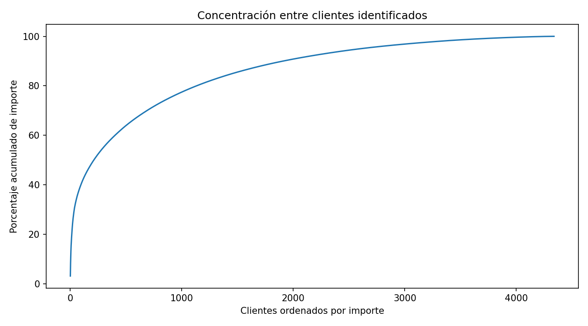

# Online Retail: informe EDA

## Alcance

**541,909 líneas de factura**, del 2010-12-01 al 2011-12-09, de un comercio británico. Fuente: [Daqing Chen, UCI (2015)](https://doi.org/10.24432/C5BW33), licencia [CC BY 4.0](https://creativecommons.org/licenses/by/4.0/). Importes nominales en GBP, calculados como Quantity × UnitPrice.

## Hallazgos principales

| Indicador | Resultado |
| --- | ---: |
| Facturas con ventas positivas | 19,960 |
| Importe de ventas positivas | GBP 10,666,684.54 |
| Factura positiva mediana / P95 | GBP 303.84 / 1,585.92 |
| Participación de Reino Unido en importe positivo | 84.61% |
| Importe de cancelaciones con prefijo C | GBP -896,812.49 |
| Total firmado, incluidos otros ajustes | GBP 9,747,747.93 |

Las ventas positivas incluyen 530,104 líneas con cantidad y precio > 0, fecha y factura presentes y sin prefijo C. El importe puede incluir portes y otros cargos; no representa beneficio ni cobro auditado.

Entre **4,338 clientes identificados** con ventas positivas, **65.58%** tiene al menos dos facturas. Los **434 clientes de mayor importe** (10%, redondeado hacia arriba) reúnen **61.38%** de GBP 8,911,407.90 de ventas identificadas. Es recurrencia dentro de la ventana, no retención por cohorte.

Noviembre de 2011 registra GBP 1,509,496.33 de ventas positivas. Diciembre termina el día 9; no debe compararse como mes completo.

## Calidad y límites

Falta CustomerID en **24.93%** de las líneas y descripción en 1,454. Se conservan **5,268 duplicados completos adicionales** y los extremos: no hay una clave de línea que confirme que sean errores. Hay 10,624 cantidades negativas, 2,515 precios cero y 2 precios negativos.

Las líneas se agregaron por factura; clientes nulos se excluyeron solo del análisis de clientes. No se emparejaron cancelaciones con ventas originales, por lo que no se estima una tasa de devolución. La concentración y la cola larga de facturas son hallazgos; la presencia de mayoristas podría contribuir, pero no se identificó a esos clientes. No hay costos ni margen.

## Evidencia

[Métricas](metricas.json), [calidad](tables/calidad.csv), [segmentos](tables/segmentos.csv), [países](tables/paises.csv), [serie mensual](tables/ventas_mensuales.csv) y [estadísticas](tables/estadisticas_numericas.csv). [Países](figures/paises.png), [facturas](figures/facturas.png) y [ventas mensuales](figures/ventas_mensuales.png).

SHA-256 de la fuente: `f5385cbb54bbebf7196389109c6b0621faab0c304e3702548165e71c84aede8b`. Datos originales intactos y excluidos de Git.
