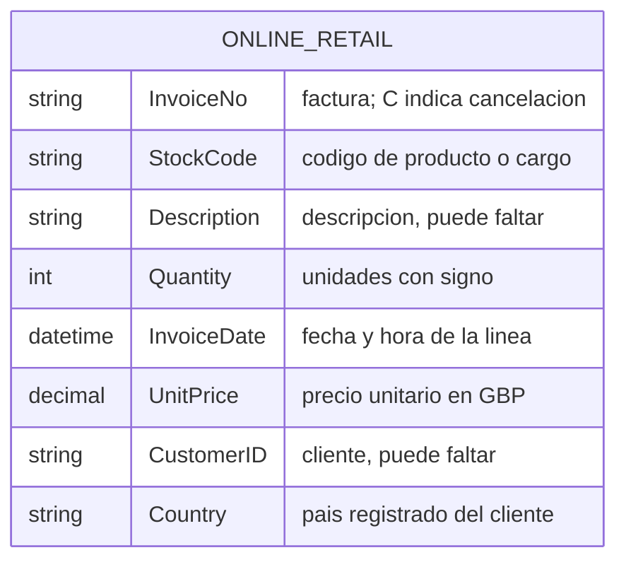
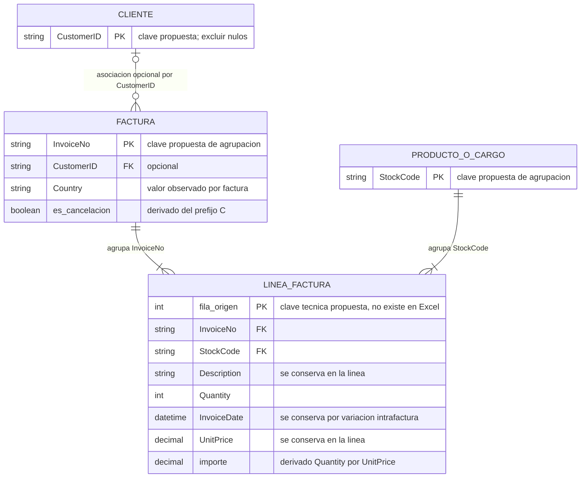

# Online Retail: informe de datos y viabilidad analítica

## 1. Propósito y alcance

Transacciones de un comercio británico: líneas de facturas con productos o cargos, cantidades, precios y cliente cuando está identificado. Permite estudiar concentración y recurrencia comercial.

**541,909 líneas de factura**, del 2010-12-01 al 2011-12-09, de un comercio británico. Fuente: [Daqing Chen, UCI (2015)](https://doi.org/10.24432/C5BW33), licencia [CC BY 4.0](https://creativecommons.org/licenses/by/4.0/). Importes nominales en GBP, calculados como Quantity × UnitPrice.

## 2. Tablas, granularidad y relaciones

| Tabla / entidad original | Filas | Una fila representa | Clave | Contenido y uso |
| --- | ---: | --- | --- | --- |
| Online Retail | 541.909 | Línea del Excel | Sin identificador único de línea | InvoiceNo, StockCode, Description, Quantity, InvoiceDate, UnitPrice, CustomerID y Country |

Las conexiones se leen de la entidad padre al detalle: uno a muchos, salvo las excepciones descritas. PK indica clave candidata y FK campo de enlace; los archivos no imponen restricciones de base de datos. Los diagramas muestran campos esenciales. En Online Retail, el segundo modelo es una propuesta; en The Look, el esquema se describe mediante exportaciones agregadas.

## 3. Normalización y construcción analítica

El Excel es una tabla plana y repite datos de factura y producto. InvoiceNo + StockCode tiene **10.684 repeticiones adicionales**: no es una clave de línea. Conservar una fila_origen técnica permitiría identificar cada registro sin borrar duplicados.

La comprobación de dependencias funcionales cuenta valores distintos, incluidos nulos, dentro de cada grupo. De 25.900 facturas, 0 tienen varios valores de cliente, 0 varios países y 43 varias fechas. De 4.070 códigos, 1.324 tienen varias descripciones y 3.603 varios precios.

Se propone separar factura, línea, cliente conocido y producto/cargo, sin presentar esas entidades como tablas existentes. La fecha original, la descripción y el precio se conservan en la línea; no se elige silenciosamente un valor por producto o factura. Importe = Quantity × UnitPrice es una medida derivada. La ausencia de cliente se conserva y las cancelaciones no tienen vínculo verificable con su compra original.

## 4. Hallazgos y denominadores

| Indicador | Resultado |
| --- | ---: |
| Facturas con ventas positivas | 19,960 |
| Importe de ventas positivas | GBP 10,666,684.54 |
| Factura positiva mediana / P95 | GBP 303.84 / 1,585.92 |
| Participación de Reino Unido en importe positivo | 84.61% |
| Importe de cancelaciones con prefijo C | GBP -896,812.49 |
| Total firmado, incluidos otros ajustes | GBP 9,747,747.93 |

Las ventas positivas incluyen 530,104 líneas con cantidad y precio > 0, fecha y factura presentes y sin prefijo C. El importe puede incluir portes y otros cargos; no representa beneficio ni cobro auditado.

Entre **4,338 clientes identificados** con ventas positivas, **65.58%** tiene al menos dos facturas. Los **434 clientes de mayor importe** (10%, redondeado hacia arriba) reúnen **61.38%** de GBP 8,911,407.90 de ventas identificadas. Es recurrencia dentro de la ventana, no retención por cohorte.

Noviembre de 2011 registra GBP 1,509,496.33 de ventas positivas. Diciembre termina el día 9; no debe compararse como mes completo.

## 5. Calidad y límites de interpretación

Falta CustomerID en **24.93%** de las líneas y descripción en 1,454. Se conservan **5,268 duplicados completos adicionales** y los extremos: no hay una clave de línea que confirme que sean errores. Hay 10,624 cantidades negativas, 2,515 precios cero y 2 precios negativos.

Las líneas se agregaron por factura; clientes nulos se excluyeron solo del análisis de clientes. No se emparejaron cancelaciones con ventas originales, por lo que no se estima una tasa de devolución. La concentración y la cola larga de facturas son hallazgos; la presencia de mayoristas podría contribuir, pero no se identificó a esos clientes. No hay costos ni margen.

## 6. Valor para el proyecto y siguiente decisión

| Decisión que puede apoyar | Base analítica | Condición / límite |
| --- | --- | --- |
| Priorizar seguimiento comercial | Cliente conocido: frecuencia e importe | Cobertura parcial; no representa a clientes anónimos |
| Planificar revisión del mix y concentración | Línea y factura positiva, por país/mes | Incluye cargos; meses parciales y sin costos |
| Separar venta y ajustes | Línea clasificada por signo y prefijo C | No equivale a devoluciones emparejadas ni cobros |

La siguiente propuesta con mayor respaldo es segmentación descriptiva de clientes conocidos y un tablero de concentración. La concentración permite evaluar dependencia comercial; no justifica campañas ni predice abandono sin evaluación adicional.

## 7. Evidencia y trazabilidad

[Métricas](metricas.json), [calidad](tables/calidad.csv), [segmentos](tables/segmentos.csv), [países](tables/paises.csv), [serie mensual](tables/ventas_mensuales.csv) y [estadísticas](tables/estadisticas_numericas.csv). [Países](figures/paises.png), [facturas](figures/facturas.png) y [ventas mensuales](figures/ventas_mensuales.png).

SHA-256 de la fuente: `f5385cbb54bbebf7196389109c6b0621faab0c304e3702548165e71c84aede8b`. Datos originales intactos y excluidos de Git.

[Diagnóstico estructural](estructura.json) · [Comprobaciones de granularidad o dependencias](tables/dependencias.csv).
