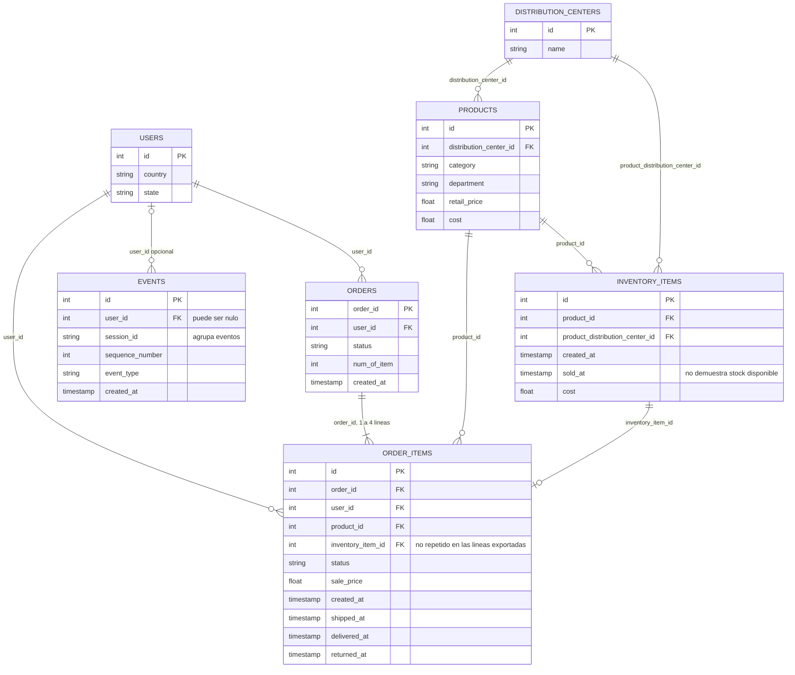
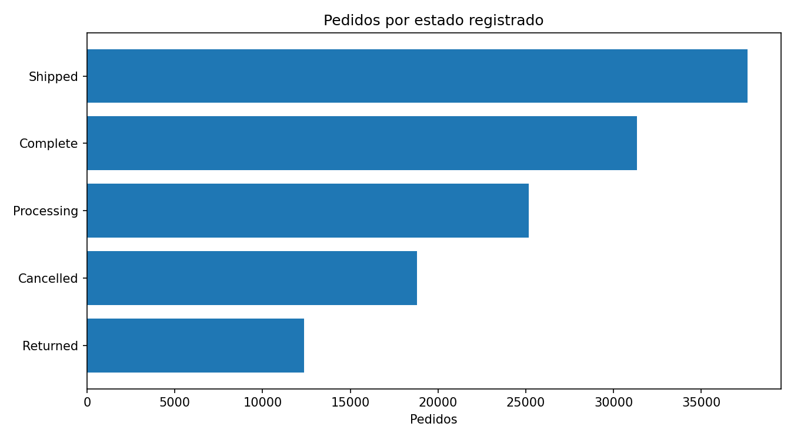

# The Look: informe de datos y viabilidad analítica

## 1. Propósito y alcance

Modelo de comercio electrónico que conecta usuarios, pedidos, catálogo, unidades de inventario y navegación. En este proyecto solo se dispone de perfiles y distribuciones agregados, no de las siete tablas individuales.

Se revisaron tres CSV agregados de BigQuery: **125.303 pedidos**, **181.458 líneas**, **100.000 usuarios**, 29.120 productos, 489.869 registros de inventario, 2.426.096 eventos y 10 centros. Los pedidos abarcan del 2019-01-09 al 2026-10-12. El origen exacto, la licencia y los trabajos de consulta no están confirmados en las exportaciones.

## 2. Tablas, granularidad y relaciones

| Tabla / entidad original | Filas | Una fila representa | Clave | Contenido y uso |
| --- | ---: | --- | --- | --- |
| users | 100.000 | Usuario | id | Perfil y ubicación |
| orders | 125.303 | Pedido | order_id | Usuario, estado, fechas y número de artículos |
| order_items | 181.458 | Línea de pedido | id | Pedido, usuario, producto, unidad, estado y sale_price |
| products | 29.120 | Producto | id | Categoría, departamento, costo y precio de catálogo |
| inventory_items | 489.869 | Unidad de inventario | id | Producto, centro, costo y fechas |
| events | 2.426.096 | Evento de navegación | id | Usuario opcional, sesión, secuencia y tipo |
| distribution_centers | 10 | Centro de distribución | id | Nombre y ubicación |

Las conexiones se leen de la entidad padre al detalle: uno a muchos, salvo las excepciones descritas. PK indica clave candidata y FK campo de enlace; los archivos no imponen restricciones de base de datos. Los diagramas muestran campos esenciales. En Online Retail, el segundo modelo es una propuesta; en The Look, el esquema se describe mediante exportaciones agregadas.

## 3. Normalización y construcción analítica

El esquema separa entidades y hechos, pero conserva redundancias: user_id está en pedido y línea; inventario replica atributos de producto y centro. Pueden representar una instantánea histórica, hipótesis que debe confirmarse antes de reemplazarlos por atributos actuales del catálogo. No se certifica una forma normal solo por tener claves únicas.

Los agregados indican claves únicas y no nulas en siete tablas y cobertura total en nueve enlaces no nulos. También indican concordancia de usuario pedido–línea y producto línea–unidad. No disponemos de filas para reconstruir esos cruces o normalizar físicamente el modelo. Los tres CSV locales son perfiles, distribuciones y relaciones; sus filas son métricas agregadas, no compradores ni pedidos.

Para una futura base analítica: una tabla de pedidos y otra de líneas, dimensiones de usuario/producto/centro y un hecho separado de eventos. Agregar líneas por pedido antes de unir; mantener eventos por sesión. El enlace por usuario entre eventos y pedidos es N:M y no demuestra atribución.

## 4. Hallazgos y denominadores

Las líneas suman **10.795.147,15**, incluyendo todos los estados; la moneda no está documentada. Solo el estado **Complete** reúne 31.327 pedidos y 2.685.055,36 de importe de líneas. Ninguno de estos importes confirma cobros o beneficio.

| Estado del pedido | Pedidos | % del total |
| --- | ---: | ---: |
| Shipped | 37.650 | 30,05% |
| Complete | 31.327 | 25,00% |
| Processing | 25.166 | 20,08% |
| Cancelled | 18.810 | 15,01% |
| Returned | 12.350 | 9,86% |

Hay **1,45 líneas por pedido** y 80.035 usuarios con pedidos. Intimates lidera en líneas (13.713); Outerwear & Coats lidera en importe (1.327.471,86). Son registros de demanda en todos los estados, no ventas netas. China reúne 33,77% de los pedidos según el país del usuario, sin confirmar destino de entrega.

**308.411 unidades carecen de sold_at** y 181.458 tienen esa fecha. Sin embargo, las **181.458 líneas vinculadas a unidades únicas apuntan a registros sin sold_at**. La igualdad entre el total de líneas y unidades con fecha no demuestra que sean las mismas unidades. Esta diferencia debe contrastarse en el origen antes de interpretar disponibilidad o ventas de inventario.

**35.231 de 117.596 líneas con ambas fechas (29,96%) tienen envío anterior a su creación**. En pedidos, la exportación no señala esa inversión. La duración media envío–entrega es 60,13 horas para 43.677 pedidos con ambas fechas; no incluye preparación ni mide cumplimiento de una promesa.

También hay fechas posteriores al inicio de las consultas. No se eliminan: las fechas de líneas y pedidos requieren aclaración antes de comparar tiempos o meses parciales.

Se registran **681.458 sesiones**. El 46,41% de los eventos no tiene user_id. Los tipos product, cart y purchase describen actividad, pero no permiten calcular conversión atribuida a pedidos: no hay un enlace directo de sesión a pedido en el esquema.

Las siete claves candidatas no presentan nulos ni repeticiones. Los nueve enlaces revisados tienen **100% de cobertura entre claves no nulas**, sin padres duplicados. num_of_item coincide con el conteo de líneas de los 125.303 pedidos comparables; tampoco aparecen diferencias de usuario o producto en las comparaciones exportadas. Un pedido tiene entre una y cuatro líneas: para analizar pedidos hay que agregar esas líneas antes de unir, aunque las claves padre sean únicas.

## 5. Calidad y límites de interpretación

La estructura permite relacionar pedidos, usuarios y productos. Los importes dependen del estado y las fechas presentan diferencias relevantes entre pedidos y líneas. **No hay base para afirmar stock disponible, ingresos netos o conversión comercial.** El análisis usa agregados exportados; valida sus balances, sin volver a consultar BigQuery ni auditar sus registros individuales.

## 6. Valor para el proyecto y siguiente decisión

| Decisión que puede apoyar | Base disponible | Condición / límite |
| --- | --- | --- |
| Describir demanda por estado, país y categoría | Distribuciones exportadas | No son ingresos netos ni destino confirmado |
| Diseñar un modelo analítico | Esquema y perfiles de relaciones | Obtener filas autorizadas para materializarlo |
| Priorizar correcciones de semántica | Alertas de fechas y unidad–línea | Confirmar fuente, extracción, moneda y estados |

La siguiente propuesta con mayor respaldo es aclarar el contrato de datos antes de un tablero de stock o logística. Los eventos permiten describir actividad agregada; un embudo de conversión necesita definición de sesión, secuencia y enlace de compra que estas exportaciones no resuelven.

## 7. Evidencia y trazabilidad

Evidencia: [métricas](metricas.json), [relaciones](tables/relaciones.csv), [alertas temporales](tables/alertas_temporales.csv), [categorías](tables/categorias.csv), [países](tables/paises.csv) y [huellas de los CSV](fuentes.json). Gráficos: [categorías](figures/categorias.png), [países](figures/paises.png), [eventos](figures/eventos.png) y [pedidos mensuales](figures/pedidos_mensuales.png).
